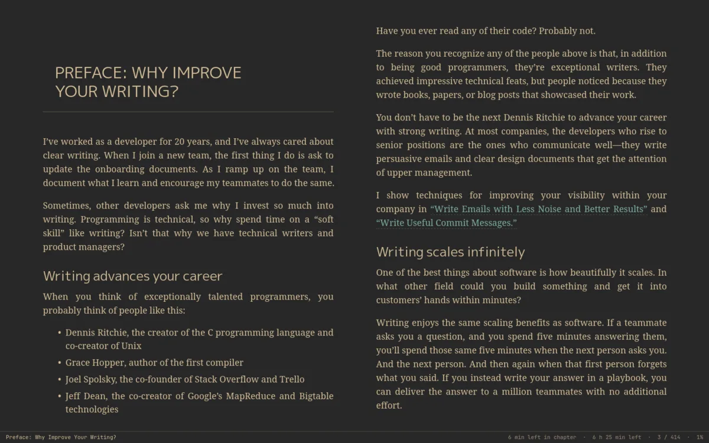
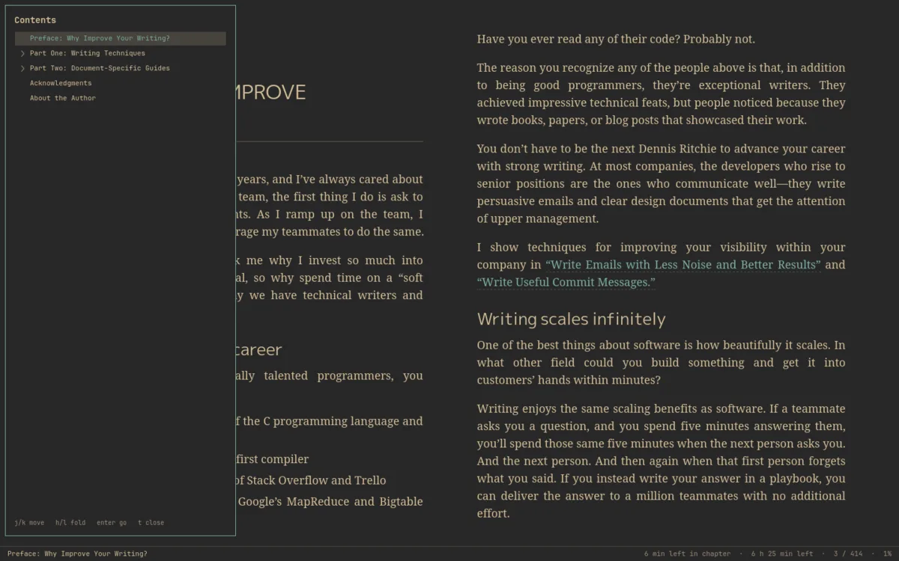
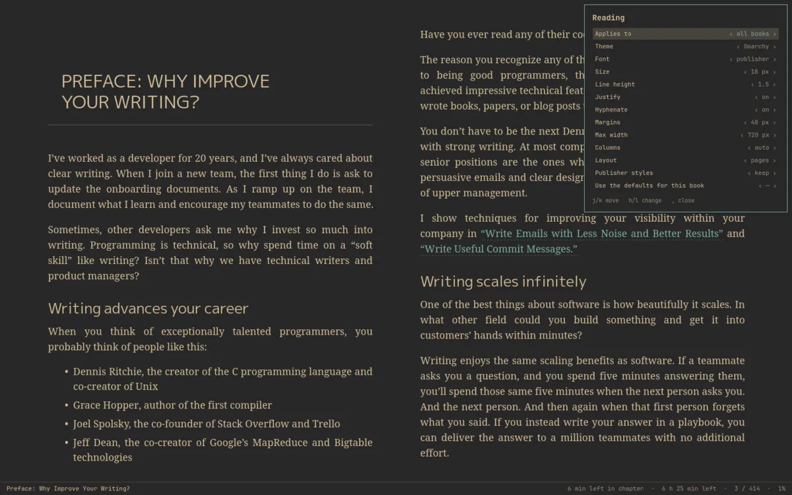
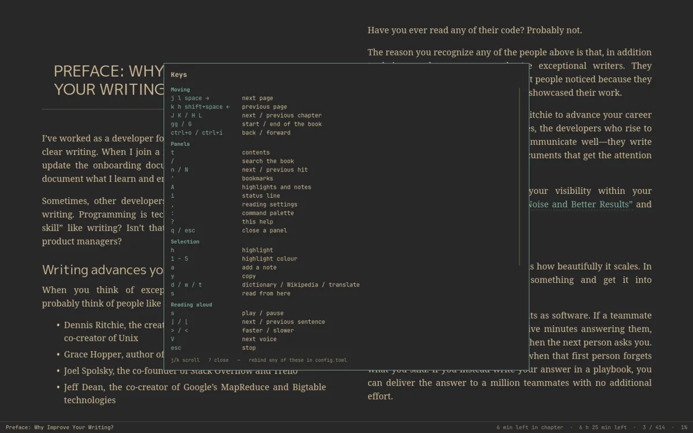
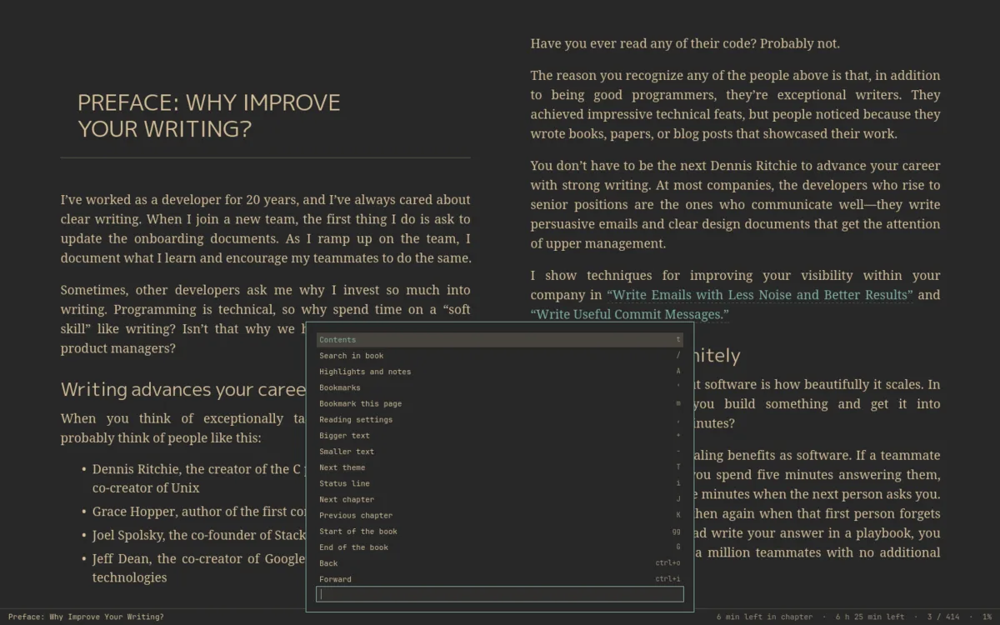

# Omaread

**A fast, keyboard-first EPUB reader for [Omarchy](https://omarchy.org).**

[](LICENSE)
[](https://omarchy.org)



Omaread wears your Omarchy theme and follows it live: colours from
`colors.toml`, sizes and control states from the theme's `shell.toml`, drawn
by the same rules the Omarchy shell uses. Books are laid out by
[foliate-js](https://github.com/johnfactotum/foliate-js), the engine behind
Foliate, inside a WebKitGTK view; everything else is Rust and GTK4.

It is keyboard-first and stays out of the way: vim keys everywhere, a `:`
command palette, and every panel drawn over the book instead of in a sidebar.

## Installing

```sh
sudo pacman -S --needed base-devel rust gtk4 libadwaita webkitgtk-6.0
bin/omaread-install            # builds and installs to ~/.local
bin/omaread-install --default  # …and makes Omaread the app for EPUB files
```

Or from the AUR: `yay -S omaread-git` (the PKGBUILD is in `packaging/aur/`).

Omaread reads the EPUBs under `~/Documents/Books`; each folder is a shelf.
Other folders go in `~/.config/omaread/config.toml`:

```toml
[library]
folders = ["~/Documents/Books", "/mnt/nas/books"]
```

## What it does

- **Vim keys, everywhere.** `?` shows every binding on screen; `:` opens a
  fuzzy command palette (`:42%`, `:p 120`, `:ch 7`, `:export`). Any binding
  can be changed in `config.toml`.
- **A library that stays out of the way.** A cover grid over your books, with
  folders as shelves, filter and sort, and reading progress under each cover.
- **Made for reading.** Paginated (auto columns when wide) or scrolled,
  publisher fonts by default, with per-book overrides for theme, font, size,
  line height, justification, hyphenation, margins and width.
- **Annotations.** Highlights in five colours, notes, bookmarks, a panel for
  each, export to Markdown or JSON, and a one-shot import from Foliate.
- **Lookups from a selection.** Wiktionary, Wikipedia and Google Translate
  (Spanish ⇄ English, picked from the text), plus local programs and web
  searches of your own.
- **Read aloud.** Through speech-dispatcher, one sentence at a time with the
  sentence highlighted; it turns pages and moves through chapters on its own,
  and your piper voices work.
- **Follows your theme live.** Any installed Omarchy theme can be the app's,
  or one book's.

## A look around

<table>
  <tr>
    <td width="50%"></td>
    <td width="50%"></td>
  </tr>
  <tr>
    <td align="center">The library — folders become shelves</td>
    <td align="center">Contents, with <code>j</code>/<code>k</code> and folding</td>
  </tr>
  <tr>
    <td width="50%"></td>
    <td width="50%"></td>
  </tr>
  <tr>
    <td align="center">Reading settings, applied as you change them</td>
    <td align="center"><code>?</code> — every binding, in one panel</td>
  </tr>
  <tr>
    <td width="50%"></td>
    <td width="50%"></td>
  </tr>
  <tr>
    <td align="center">The command palette — every command, fuzzy</td>
    <td></td>
  </tr>
</table>

## Keys

Press `?` anywhere for this list on screen. Any binding can be changed in
`config.toml` — the app re-reads it as you edit.

Library

| Keys | Action |
|---|---|
| `h` `j` `k` `l` / arrows | move |
| Enter | open |
| `/` | filter the whole library (Esc clears) |
| `o` | cycle sort: recent, title, author, progress, added |
| Tab / Shift-Tab | next / previous shelf |
| `gg` / `G` | first / last book |
| `gr` | rescan |
| `:` | command palette |
| `q` | quit |

Reading

| Keys | Action |
|---|---|
| `j` `l` Space → | next page |
| `k` `h` Shift-Space ← | previous page |
| `J` `K` / `H` `L` | next / previous chapter |
| `gg` / `G` | start / end of the book |
| `Ctrl-o` / `Ctrl-i` | back / forward |
| `t` | table of contents (`j`/`k` move, `h`/`l` fold, Enter go) |
| `/` | search the book (Alt+c case, Alt+w whole words, Alt+d accents) |
| `n` / `N` | next / previous match (Esc clears) |
| `:` | command palette: every command, fuzzy; also `:42%`, `:p 120`, `:ch 7`, `:export` |
| select text | a card with colours, a note and `y` copy; `h` highlight, `1`–`5` color, `a` note, `d` dictionary, `w` Wikipedia, `t` translate |
| click a highlight | `a` note, `1`–`5` recolor, `h` remove, `x` delete |
| `s` | read aloud / pause (`]`/`[` next/previous sentence, `<`/`>` speed, `V` voice, Esc stop); on a selection, read from there |
| `m` | bookmark this page (again to remove) |
| `A` / `'` | highlights / bookmarks (`j`/`k`, Enter go, `a` note, `dd` delete) |
| `:export` | highlights and notes to `~/Documents/Omaread/<title>.md` (`:export json` too) |
| `,` | reading settings (`j`/`k` move, `h`/`l` change) |
| `+` / `-` | bigger / smaller text |
| `T` | cycle theme: Omarchy, light, dark, sepia |
| `i` | toggle the status line |
| `?` | help |
| `q` / Esc | back to the library |

Reading settings (theme, font, size, line height, justification,
hyphenation, margins, width, columns, pages or scroll, how much of the
publisher's styling to keep) apply to all books, or to one book when you
switch "Applies to" to "this book". Any installed Omarchy theme can be a
book's theme.

For hyphenation, install the dictionaries: `sudo pacman -S hyphen-en hyphen-es`.

Your place in every book is saved as you read.

## Rebinding keys

In `~/.config/omaread/config.toml`. Actions are named; a listed action keeps
only the keys you give it:

```toml
[keymap.reader]
next_page = ["j", "l", "space"]
prev_page = ["k", "h"]
speak = "p"

[keymap.library]
open = ["enter", "o"]
```

Key names read as they do above (`j`, `G`, `space`, `ctrl+o`, `enter`,
`shift+tab`, `page_down`, `f1`). Unknown contexts, actions and keys are
ignored with a note on stderr.

## Lookups

Lookups come from Wiktionary, Wikipedia and Google Translate (Spanish ⇄
English, picked from the text). Answers are cached for a month. Providers
are configurable, including local programs (run without a shell) and web
searches:

```toml
[[lookup.provider]]
name = "Dictionary"
kind = "builtin.wiktionary"
key = "d"

[[lookup.provider]]
name = "Translate"
kind = "builtin.translate"
key = "t"
pair = ["es", "en"]

[[lookup.provider]]
name = "Local"
kind = "command"
key = "D"
command = ["sdcv", "-n", "--", "{text}"]

[[lookup.provider]]
name = "Search"
kind = "url"
key = "g"
url = "https://duckduckgo.com/?q={text}"
```

Commands run without a shell, and a selection never becomes an option
(leading dashes are dropped); end your options with `--` where the program
supports it.

## Reading aloud

Reading aloud goes through speech-dispatcher (so your piper voices work),
one sentence at a time with the sentence highlighted; it turns pages and
moves through chapters on its own. Voice and speed are remembered.

## On the command line

```
omaread [book.epub]         open a book, or the library
omaread scan                refresh the library without opening a window
omaread status [--json]     what you're reading: title, chapter, progress, time left
omaread check-library       open every book and report the ones that won't
omaread lookup d goroutine  what the lookup card would show
omaread import-foliate      bring Foliate's positions and annotations over
```

`omaread status --json` is there for a bar or a script; `omaread
check-library --json` is the smoke test for a pile of EPUBs.

## Coming from Foliate?

On first run Omaread brings over your reading positions, highlights, notes and
bookmarks (`omaread import-foliate` does it again; nothing already in Omaread
is overwritten). The status line shows the chapter, time left in the chapter
and the book (learned from your own reading pace), the page and how far
through you are.

## License

MIT. [foliate-js](https://github.com/johnfactotum/foliate-js) is vendored
under `web/foliate-js` with its own MIT license.
