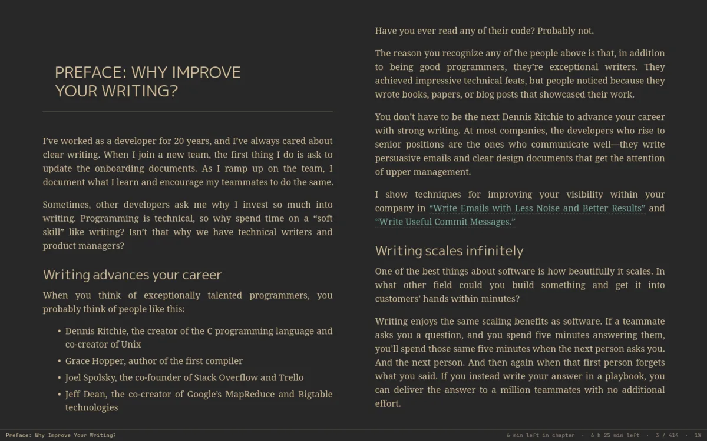
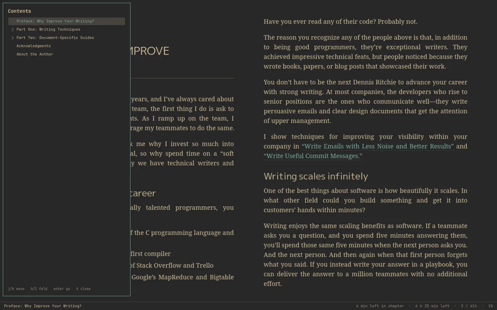
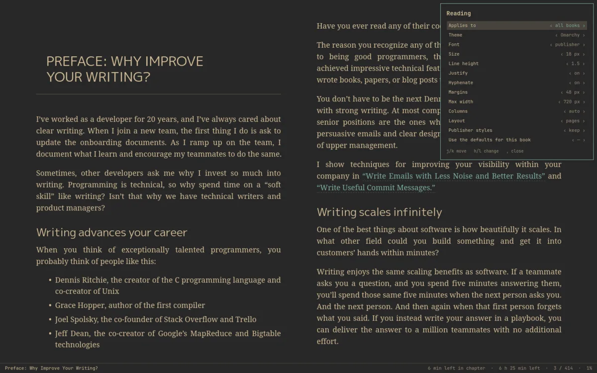
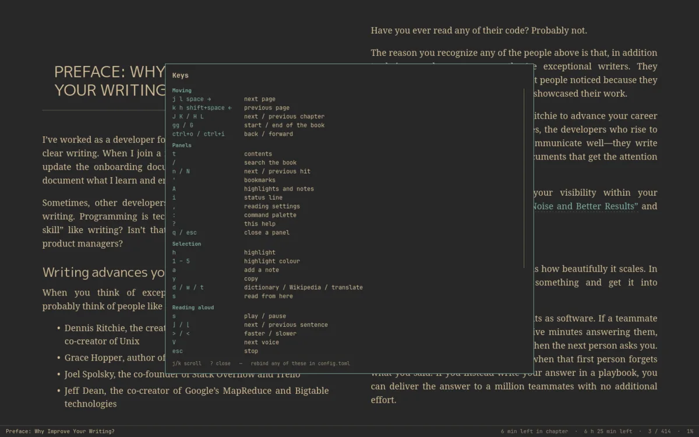
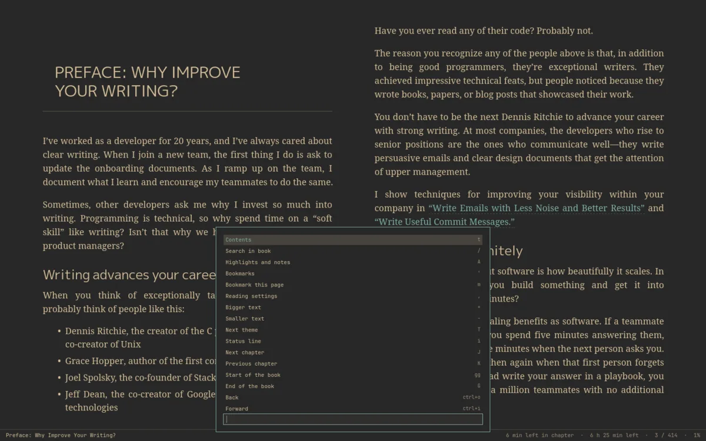

# Omaread

**A fast, keyboard-first EPUB reader for [Omarchy](https://omarchy.org).**

[](LICENSE)
[](https://omarchy.org)

[](docs/omaread.mp4)



Omaread wears your Omarchy theme and follows it live: colours from
`colors.toml`, sizes and control states from the theme's `shell.toml`, drawn
by the same rules the Omarchy shell uses. It also follows the window opacity
setting under Appearance > Windows: with Glassy Windows on, its surfaces turn
see-through and the compositor blurs the desktop behind them. Books are laid
out by
[foliate-js](https://github.com/johnfactotum/foliate-js), the engine behind
Foliate, inside a WebKitGTK view; everything else is Rust and GTK4.

It is keyboard-first and stays out of the way: vim keys everywhere, a `:`
command palette, and every panel drawn over the book instead of in a sidebar.

## Installing

```sh
sudo pacman -S --needed base-devel rust gtk4 libadwaita webkitgtk-6.0 alsa-lib
bin/omaread-install            # builds and installs to ~/.local
bin/omaread-install --default  # …and makes Omaread the app for EPUB files
```

Or from the AUR, prebuilt or built from the latest commit (the PKGBUILDs are
in `packaging/aur/`):

```sh
yay -S omaread-bin
yay -S omaread-git
```

The library starts empty. Press `a` (or **+ Add folder**) and pick a folder:
it shows in the sidebar as a tree of the folders inside it, and picking any
of them shows every EPUB under it. Add as many as you like; they're saved to
`~/.config/omaread/config.toml`, which you can also edit by hand:

```toml
[library]
folders = ["~/Books", "/mnt/nas/books"]
```

## What it does

- **Vim keys, everywhere.** `?` shows every binding on screen; `:` opens a
  fuzzy command palette (`:42%`, `:p 120`, `:ch 7`, `:export`). Any binding
  can be changed in `config.toml`.
- **A library that stays out of the way.** A cover grid over your books, with
  your folders as a tree in the sidebar, filter and sort, and reading progress under each cover.
  A "Continue reading" row keeps the books in progress at hand: `c` opens the
  latest, `1`–`6` the others.
- **Made for reading.** Paginated (auto columns when wide) or scrolled,
  publisher fonts by default, with per-book overrides for theme, font, size,
  line height, justification, hyphenation, margins and width.
- **Images up close.** Click an image (or label it with `f`) to open it over
  the page; `+`/`-` zoom, `0` fits, `1` is actual size, `h`/`j`/`k`/`l` move,
  `y` copies it.
- **Footnotes in place.** A link to a footnote or endnote opens the note in
  a card beside it; Enter goes to the note, `y` copies it.
- **Annotations.** Highlights in five colours, notes, bookmarks, a panel for
  each, a search across every book's highlights and notes (`A` in the
  library; Enter opens the book at the highlight), export to Markdown or JSON, and a one-shot import from Foliate.
- **Lookups from a selection.** Wiktionary, Wikipedia and Google Translate
  (Spanish ⇄ English, picked from the text), plus local programs and web
  searches of your own. Optionally, an explanation from Claude Code, Codex
  or OpenCode.
- **Read aloud.** Kokoro by default, through a local Kokoro-FastAPI server:
  one sentence at a time with the sentence highlighted, turning pages and
  moving through chapters on its own. Audio plays as the server makes it, the
  next sentences are ready before they are needed, and stopping and starting
  again resumes at the sentence you stopped on. A compact player provides
  playback, sentence, speed and voice controls. Roman numerals read as
  numbers (`Part I` is "part one"). While it reads, Omaread is an MPRIS
  player: media keys, `playerctl` and the bar can pause it and skip
  sentences, and see the book, chapter and cover. Piper still works through
  speech-dispatcher if you set `[tts] engine = "piper"`.
- **Reading stats.** Time read each day (page turns and reading aloud;
  idle stretches don't count), streaks, the books you read most and the
  ones you finished: `:stats` in the app, `omaread stats [--json]` outside.
- **Follows your theme live.** Any installed Omarchy theme can be the app's,
  or one book's.

## A look around

<table>
  <tr>
    <td width="50%"></td>
    <td width="50%"></td>
  </tr>
  <tr>
    <td align="center">The library — folders become shelves</td>
    <td align="center">Contents, with <code>j</code>/<code>k</code> and folding</td>
  </tr>
  <tr>
    <td width="50%"></td>
    <td width="50%"></td>
  </tr>
  <tr>
    <td align="center">Reading settings, applied as you change them</td>
    <td align="center"><code>?</code> — every binding, in one panel</td>
  </tr>
  <tr>
    <td width="50%"></td>
    <td width="50%"></td>
  </tr>
  <tr>
    <td align="center">The command palette — every command, fuzzy</td>
    <td></td>
  </tr>
</table>

## Keys

Press `?` anywhere for this list on screen. Any binding can be changed in
`config.toml` — the app re-reads it as you edit.

Library

| Keys | Action |
|---|---|
| `h` `j` `k` `l` / arrows | move |
| Enter | open |
| `c` / `1`–`6` | continue the latest book / one from the Continue reading row |
| `A` | search the highlights and notes of every book |
| `/` | filter the whole library (Esc clears) |
| `o` | cycle sort: recent, title, author, progress, added |
| Tab / Shift-Tab | next / previous folder in the sidebar |
| Space | open / close the folder |
| `a` | add a folder |
| `D` | remove the folder from the library (the files stay) |
| `gg` / `G` | first / last book |
| `gr` | rescan |
| `:` | command palette |
| `q` | quit |

Reading

| Keys | Action |
|---|---|
| `j` `l` Space → | next page |
| `k` `h` Shift-Space ← | previous page |
| `J` `K` / `H` `L` | next / previous chapter |
| `gg` / `G` | start / end of the text |
| `Ctrl-o` / `Ctrl-i` | back / forward |
| `t` | table of contents (`j`/`k` move, `h`/`l` fold, Enter go) |
| `/` | search the book (Alt+c case, Alt+w whole words, Alt+d accents) |
| `n` / `N` | next / previous match (Esc clears) |
| `:` | command palette: every command, fuzzy; also `:42%`, `:p 120`, `:ch 7`, `:export`, `:stats` |
| select text | a card with colours, a note and `y` copy; `h` highlight, `1`–`5` color, `a` note, `d` dictionary, `w` Wikipedia, `t` translate |
| `f` | label the links and images on the page; type a label to follow the link or open the image |
| `v` | select from the keyboard: `w`/`b` words, `(`/`)` sentences, `{`/`}` paragraphs, `j`/`k` lines, `o` the other end; Enter opens the card, `y` copies, Esc cancels |
| click a highlight | `a` note, `1`–`5` recolor, `h` remove, `x` delete |
| `s` | read aloud / pause (`]`/`[` next/previous sentence, `<`/`>` speed, `V` voices, Esc stop); on a selection, read from there |
| `m` | bookmark this page (again to remove) |
| `A` / `'` | highlights / bookmarks (`j`/`k`, Enter go, `a` note, `dd` delete) |
| `:export` | highlights and notes to `~/Documents/Omaread/<title>.md` (`:export json` too) |
| `,` | reading settings (`j`/`k` move, `h`/`l` change) |
| `+` / `-` | bigger / smaller text |
| `T` | cycle theme: Omarchy, light, dark, sepia |
| `i` | toggle the status line |
| `?` | help |
| `q` / Esc | back to the library |

Reading settings (theme, font, size, line height, justification,
hyphenation, margins, width, columns, pages or scroll, how much of the
publisher's styling to keep) apply to all books, or to one book when you
switch "Applies to" to "this book". Any installed Omarchy theme can be a
book's theme.

For hyphenation, install the dictionaries: `sudo pacman -S hyphen-en hyphen-es`.

Your place in every book is saved as you read.

## Rebinding keys

In `~/.config/omaread/config.toml`. Actions are named; a listed action keeps
only the keys you give it:

```toml
[keymap.reader]
next_page = ["j", "l", "space"]
prev_page = ["k", "h"]
speak = "p"

[keymap.library]
open = ["enter", "o"]
```

Key names read as they do above (`j`, `G`, `space`, `ctrl+o`, `enter`,
`shift+tab`, `page_down`, `f1`). Unknown contexts, actions and keys are
ignored with a note on stderr.

## Lookups

Lookups come from Wiktionary, Wikipedia and Google Translate (Spanish ⇄
English, picked from the text). Answers are cached for a month. Providers
are configurable, including local programs (run without a shell) and web
searches:

```toml
[[lookup.provider]]
name = "Dictionary"
kind = "builtin.wiktionary"
key = "d"

[[lookup.provider]]
name = "Translate"
kind = "builtin.translate"
key = "t"
pair = ["es", "en"]

[[lookup.provider]]
name = "Local"
kind = "command"
key = "D"
command = ["sdcv", "-n", "--", "{text}"]

[[lookup.provider]]
name = "Search"
kind = "url"
key = "g"
url = "https://duckduckgo.com/?q={text}"
```

Commands run without a shell, and a selection never becomes an option
(leading dashes are dropped); end your options with `--` where the program
supports it.

### Asking an agent

A lookup can also be answered by a coding agent's CLI: Claude Code, Codex
or OpenCode. It explains the selection using the paragraph around it,
the chapter and the book, without spoiling what comes later. This is off
until you turn it on:

```toml
[llm]
enabled = true
agent = "claude"     # claude, codex, opencode, or one of your own
key = "e"            # adds "Explain" on this key
# context = "chapter"    # also send the chapter so far (default: "passage")
# max_context = 12000    # characters of it, its end kept
# language = "English"   # the answer's language; else the text's own
# timeout = 120          # seconds
# prompt = "…{text}…{passage}…{before}…{title}…{chapter}…{language}…"

[llm.claude]
model = "haiku"

[llm.codex]
model = "gpt-5-codex-mini"

[llm.opencode]
model = "anthropic/claude-haiku-4-5"
```

By default a question carries the book's title and authors, the chapter's
name and the paragraph around the selection. With `context = "chapter"` it
also carries the chapter so far, from its start up to the selection (the
last `max_context` characters of it), so the agent knows who and what the
passage is about. Omaread reads that text and puts it in the prompt; the
agent never gets the book's file.

Each agent runs once per question, in an empty directory, with the prompt
on stdin where its CLI allows it. A book's text can carry instructions
meant for an agent, so none of them gets tools that act: Claude Code runs
without tools, sessions or MCP servers, Codex runs in its read-only sandbox,
and OpenCode runs beside a project config that denies every permission.
OpenCode still starts the MCP servers from your config, so its answers can
take longer. A command of your own gets no such guard; make sure it can't
act on what it reads. An agent the
app can't find on its `PATH` takes `program = "/full/path"`. For any other
tool, give it a command; the prompt goes to stdin unless an argument is
`{prompt}`:

```toml
[llm.mine]
command = ["my-llm", "--model", "{model}"]
model = "small"
```

More agent lookups can sit beside the others under `[[lookup.provider]]`
with `kind = "llm"` and their own `agent`, `model` and `prompt`. Agent
answers aren't cached, and changes to `[llm]` apply when the app restarts.

## Reading aloud

Reading aloud uses Kokoro by default. Start a local
[Kokoro-FastAPI](https://github.com/remsky/Kokoro-FastAPI) server (the CPU
image is enough):

```sh
docker run -p 8880:8880 ghcr.io/remsky/kokoro-fastapi-cpu:latest
```

then press `s` in a book. One sentence is synthesized at a time, played as
it arrives, and highlighted. The next sentences are made while the current
one plays, and a paragraph's first sentence is fetched as the paragraph
starts, so playback joins without a synthesis pause. It turns pages and moves
through chapters on its own. Voice and speed are remembered; speed changes in
0.05× steps, and clicking the speed value offers presets from 0.5× to 4×.
`Esc` stops; the next `s` resumes at the sentence you stopped on.

The server is configurable in `~/.config/omaread/config.toml` (the engine is
chosen when the app starts):

```toml
[tts]
engine = "kokoro"                       # or "piper"
url = "http://127.0.0.1:8880/v1"        # OpenAI-compatible base URL
model = "kokoro"
voice = "af_heart"                      # af_*/am_* (US), bf_*/bm_* (UK), …
# api_key = "only-if-the-server-sets-API_KEYS"
```

To keep using Piper, it must be set up as a speech-dispatcher module as
before; Omaread then speaks through speech-dispatcher instead:

```toml
[tts]
engine = "piper"
```

`V` lists every voice the active engine offers, with its language noted, so a
book in another language can still be read with a suitable voice. The player
shows the current sentence and speed; `Esc` stops and `s` pauses.

## On the command line

```
omaread [book.epub]         open a book, or the library
omaread open <book> [--at CFI | --fraction F | --chapter N]
                            open a book in the running app, at a place
omaread list [--reading]    the library, most recently opened first
omaread show <book>         one book: progress, chapters, annotation counts
omaread toc <book>          its table of contents
omaread text <book> [--chapter N | --section N]
                            a chapter as plain text (default: the one you're in)
omaread search <book> <text>
                            find text in a book, with the words around it
omaread annotations [<book>] [--query text]
                            highlights and notes, of one book or all of them
omaread status [--json]     what you're reading: title, chapter, progress, time left
omaread stats [--days N]    reading time per day, streaks, books finished
omaread scan                refresh the library without opening a window
omaread check-library       open every book and report the ones that won't
omaread lookup d goroutine  what the lookup card would show
omaread import-foliate      bring Foliate's positions and annotations over
omaread commands [--json]   every command and its options
```

A book is named by its path, its id, or part of its title or author.

The commands are made to be used by scripts and coding agents as well as by
hand. `--json` prints one JSON object on stdout, and errors go to stderr (as
JSON with `--json`). The exit code is 0 on success, 1 when something failed,
and 2 for a bad request: wrong usage, no such book, or a name that matches
several. Nothing prompts. Long output is cut (`--limit`, `--max-chars`) and
the JSON says where to continue (`truncated`, `next`, `--offset`).
`omaread commands --json` describes every command for an agent to read.
`omaread status --json` is there for a bar; `omaread check-library --json`
is the smoke test for a pile of EPUBs.

## Coming from Foliate?

On first run Omaread brings over your reading positions, highlights, notes and
bookmarks (`omaread import-foliate` does it again; nothing already in Omaread
is overwritten). The status line shows the chapter, time left in the chapter
and the book (learned from your own reading pace), the page and how far
through you are.

## License

MIT. [foliate-js](https://github.com/johnfactotum/foliate-js) is vendored
under `web/foliate-js` with its own MIT license.
